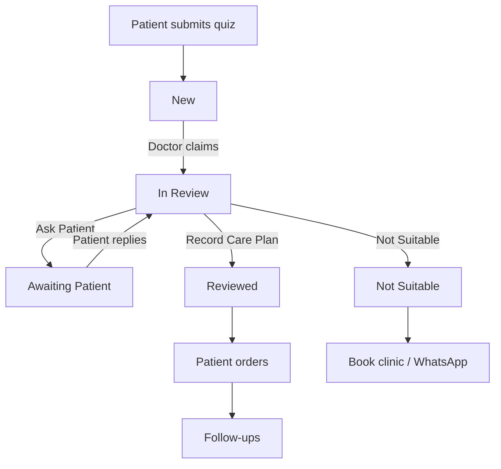

# Assessment Flow (Staff)

How doctors work through submitted assessments in the dashboard, from the patient's quiz to a care plan. It
covers the staff side before follow-ups. Patient-side states: `docs/patient-journey.md`. Follow-ups after the
order: `docs/patient-journey-simple.md`.

- Queue: `/dashboard/assessments` (`views/pages/dashboard/assessments.php`)
- Row component: `views/components/dashboard/assessment-row.php`
- Statuses, decisions and seed data: `includes/assessments-data.php`
- Session store, claim action and queue groups: `includes/assessments-state.php`
- Review page: `/dashboard/assessment?id=<assessment id>` (planned)
- Quiz questions: `includes/assessment-quiz-data.php`
- Patient summary field: `assessment` in `includes/dashboard-patients-data.php`
- Workflow reference for doctors and product owners: `/dashboard/assessment-workflow`
  (`views/pages/dashboard/assessment-workflow.php`)
- When a status, rule or transition here changes, update this file in the same commit.

Status: ✅ built · ⚠️ partial · ❌ missing

---

## Flow

1. **Queue**: the doctor opens the Assessments list and claims an unclaimed case.
2. **Review**: quiz answers, photos, health flags, patient history (past orders, care products bought) and an
   internal note.
3. **Decision**: the doctor picks one action:
   - **Ask Patient**: sends a question. The case waits for the reply, then goes back to In Review.
   - **Record Care Plan**: Prescription, Basic Products Only or Consultation.
   - **Not Suitable**: the patient is referred to the clinic.
4. **Handover**: after a care plan the patient orders, and the order starts the follow-up chain
   (`/dashboard/follow-ups`).

---

## Statuses

| Status | Meaning | Owner | Next |
|---|---|---|---|
| New | Submitted, nobody has claimed it | Any doctor | Claim → In Review |
| In Review | Claimed; the doctor is reviewing | Claiming doctor | Ask Patient, Record Care Plan or Not Suitable |
| Awaiting Patient | The doctor asked a question | Patient | Reply → In Review (same doctor) |
| Reviewed | Care plan recorded | — | Patient orders → Follow-ups |
| Not Suitable | Not suitable for online care | — | Patient books a clinic visit or uses WhatsApp |

### Mapping to other surfaces

| Assessment status | Patient state (`/account`) | Patient list (`assessment` field) |
|---|---|---|
| — (no assessment) | `new` | Not Submitted |
| New, In Review | `pending` | Pending Review |
| Awaiting Patient | `needs_info` | Pending Review |
| Reviewed | `plan_ready` | Reviewed |
| Not Suitable | `not_suitable` (❌ missing) | Reviewed |

---

## Rules

| Rule | Value |
|---|---|
| Claiming | Self-claim. A doctor claims a New case from the queue; the case is then theirs |
| One owner | Only the claiming doctor can ask, record a plan or mark Not Suitable |
| Questions | No limit. Each Ask Patient → reply round is kept in the case thread |
| Patient reply | Returns the case to In Review with the same doctor |
| Decision | One final decision per assessment: Record Care Plan or Not Suitable |
| Care plan types | Prescription, Basic Products Only, Consultation. Decision types, not purchase statuses |
| Purchase | A care plan does not require a purchase. Buying a basic product never marks a prescription as fulfilled |
| Internal note | Staff only. Never shown to the patient |

---

## Screens

### Queue (`/dashboard/assessments`) ✅

- Collapsible groups, as on Follow-ups: Unclaimed (New), Mine (In Review, Awaiting Patient), Reviewed (Reviewed
  and Not Suitable, last 14 days, all doctors).
- Row: assessment and patient ID, name, photo count, reported changes, when first noticed, health flags, status,
  date (Submitted, Asked or Decided) and a hint (waiting time, question round, or decision and doctor).
- Order: Unclaimed oldest first. Mine: patient replies (Patient Replied badge), then In Review oldest first, then
  Awaiting Patient. Reviewed newest first.
- Actions: Claim (Unclaimed, posts and moves the case to Mine), Review (Mine), View (Reviewed).
- Demo: Mine belongs to the `signed_in` doctor in `includes/assessments-data.php`. Reset Demo (`?reset=1`)
  reseeds the session.

### Review page (`/dashboard/assessment?id=`) ❌ planned

- Main column: quiz answers grouped by question, photos, health flags, patient history.
- Side panel: decision form (Ask Patient / Record Care Plan / Not Suitable), internal note, question thread.

---

## Gaps

| Item | Status | Notes |
|---|---|---|
| Queue page with self-claim | ✅ | Session demo, no database |
| Review page | ❌ | Review and View on the queue link to it already |
| Session demo state shared with `/account` | ❌ | Queue state is dashboard-only for now |
| Staff sign-in | ❌ | Mine uses a fixed demo doctor (`signed_in`) |
| Patient list `assessment` field and `doctor` | ⚠️ | Separate seed in `includes/dashboard-patients-data.php`; not read from assessments |
| Multiple question rounds on `/account` | ⚠️ | Patient side supports one round only (`docs/patient-journey.md`) |
| `not_suitable` patient state | ❌ | Not in `includes/preview-states.php` |
| Prescription flow | ❌ | Open question below |
| Overview counts linked to the queue | ⚠️ | `includes/dashboard-overview-data.php` shows sample counts; "View assessments" has no target |

---

## Open questions

- **Prescription**: issued on the review page, or on a separate Prescriptions page (sidebar link is also `#`)?
  Covers items, dosage, validity and refill approval.
- Can a doctor release a claimed case back to the queue, for example when unavailable?
- What happens when a patient never replies to a question: reminder, auto-close, or stays open?
- Not Suitable: fixed reasons list or free text? What does the patient see?

---

## Changelog

- 2026-11-24: Queue page built: Unclaimed, Mine and Reviewed groups; self-claim.
- 2026-11-24: First version. Self-claim, unlimited question rounds and Not Suitable agreed; prescription open.
