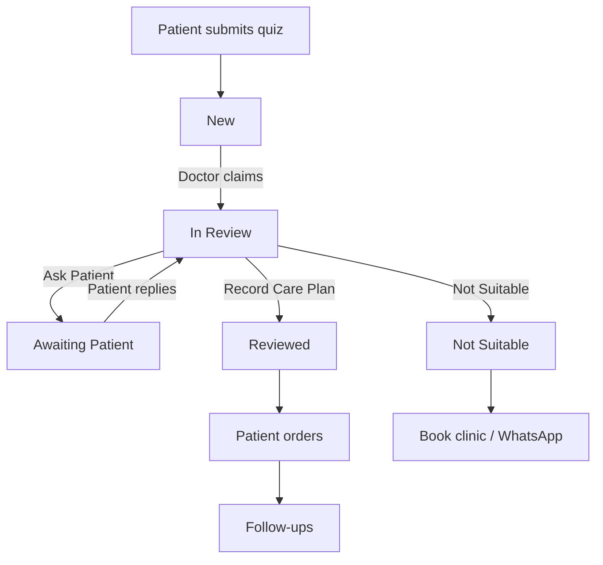

# Assessment Flow (Staff)

How doctors work through submitted assessments in the dashboard, from the patient's quiz to a care plan. It
covers the staff side before follow-ups. Patient-side states: `docs/patient-journey.md`. Follow-ups after the
order: `docs/patient-journey-simple.md`.

- Queue: `/dashboard/assessments` (`views/pages/dashboard/assessments.php`)
- Review page: `/dashboard/assessment?id=<assessment id>` (`views/pages/dashboard/assessment.php`)
- Components: `views/components/dashboard/assessment-row.php`, `assessment-answers.php`, `assessment-decision.php`,
  `assessment-thread.php`, `assessment-checkins.php`
- Statuses, decisions and seed data: `includes/assessments-data.php`
- Session store, actions and queue groups: `includes/assessments-state.php`
- Quiz questions: `includes/assessment-quiz-data.php`
- Patient summary field: `assessment` in `includes/dashboard-patients-data.php`
- Workflow reference for doctors and product owners: `/dashboard/assessment-workflow`
  (`views/pages/dashboard/assessment-workflow.php`)
- When a status, rule or transition here changes, update this file in the same commit.

Status: ✅ built · ⚠️ partial · ❌ missing

---

## Flow

1. **Queue**: the doctor opens the Assessments list and claims an unclaimed case.
2. **Review**: quiz answers, photos, health flags, patient history (past orders, care products bought) and an
   internal note.
3. **Decision**: the doctor picks one action:
   - **Ask Patient**: sends a question. The case waits for the reply, then goes back to In Review.
   - **Record Care Plan**: Prescription, Basic Products Only or Consultation.
   - **Not Suitable**: the patient is referred to the clinic.
4. **Handover**: after a care plan the patient orders, and the order starts the follow-up chain
   (`/dashboard/follow-ups`).

---

## Statuses

| Status | Meaning | Owner | Next |
|---|---|---|---|
| New | Submitted, nobody has claimed it | Any doctor | Claim → In Review |
| In Review | Claimed; the doctor is reviewing | Claiming doctor | Ask Patient, Record Care Plan or Not Suitable |
| Awaiting Patient | The doctor asked a question | Patient | Reply → In Review (same doctor) |
| Reviewed | Care plan recorded | — | Patient orders → Follow-ups |
| Not Suitable | Not suitable for online care | — | Patient books a clinic visit or uses WhatsApp |

### Mapping to other surfaces

| Assessment status | Patient state (`/account`) | Patient list (`assessment` field) |
|---|---|---|
| — (no assessment) | `new` | Not Submitted |
| New, In Review | `pending` | Pending Review |
| Awaiting Patient | `needs_info` | Pending Review |
| Reviewed | `plan_ready` | Reviewed |
| Not Suitable | `not_suitable` (live only) | Reviewed |

### Live link with `/account`

The dashboard and `/account` share one session store (`includes/assessments-state.php`). The demo patient is
`account_patient` (PT-2001, Aisyah) in `includes/assessments-data.php`; her assessment is AS-3004 (New).

- `/account` (live, the default preview) shows her latest assessment above her orders, mapped as in the table
  above. `views/pages/account.php` builds `$account_live_assessment`; `views/pages/account/full.php` merges it
  over the sample.
- Awaiting Patient: `/account` shows the latest question. The reply posts to `/account` (`action=patient_reply`,
  `assets/js/account-reply.js`); the case returns to In Review with Patient Replied. Photos are counted only.
- Reviewed: the doctor’s message is the plan note. Prescription and Basic Products Only show sample products
  until prescription items are recorded; Consultation shows the note only.
- Not Suitable: “Your doctor’s advice” with the message and WhatsApp.
- Earlier rounds: answered questions show above the open question (Awaiting Patient), and under “Your messages
  with <doctor>” in the other states (`thread_history`, `account/doctor-thread` `history`).
- Questions asked about one answer show “About your answer: …” above the doctor’s bubble (`message_about`,
  history `about`).
- The session reseeds when the seed data changes, or with Reset Demo.

---

## Rules

| Rule | Value |
|---|---|
| Claiming | Self-claim. A doctor claims a New case from the queue; the case is then theirs |
| One owner | Only the claiming doctor can ask, record a plan or mark Not Suitable |
| Questions | No limit. Each Ask Patient → reply round is kept in the case thread |
| Patient reply | Returns the case to In Review with the same doctor |
| Decision | One final decision per assessment: Record Care Plan or Not Suitable |
| Care plan types | Prescription, Basic Products Only, Consultation. Decision types, not purchase statuses |
| Purchase | A care plan does not require a purchase. Buying a basic product never marks a prescription as fulfilled |
| Internal note | Staff only. Never shown to the patient |

---

## Screens

### Queue (`/dashboard/assessments`) ✅

- Collapsible groups, as on Follow-ups: Unclaimed (New), Mine (In Review, Awaiting Patient), Reviewed (Reviewed
  and Not Suitable, last 14 days, all doctors).
- Row: assessment and patient ID, name, photo count, reported changes, when first noticed, health flags, status,
  date (Submitted, Asked or Decided) and a hint (waiting time, question round, or decision and doctor).
- Order: Unclaimed oldest first. Mine: patient replies (Patient Replied badge), then In Review oldest first, then
  Awaiting Patient. Reviewed newest first.
- Actions: Claim (Unclaimed, posts and moves the case to Mine), Review (Mine), View (Reviewed).
- Demo: Mine belongs to the `signed_in` doctor in `includes/assessments-data.php`. Reset Demo (`?reset=1`)
  reseeds the session.

### Review page (`/dashboard/assessment?id=`) ✅

One task per place, each with its own form:

- Main column: Answers (health flags as badges, then every quiz answer), Questions, Photos (placeholders in the
  demo), Patient History (contact, last purchase, clinic visits, treatment), Check-ins.
- Questions (the conversation, not a decision): the thread, then **Ask the Patient** while In Review, or the wait
  for a reply with Add Demo Reply (demo only) while Awaiting Patient.
- Answers: grouped (Profile, Hair, Health and Goal) with short labels from `answer_labels` in
  `includes/assessments-data.php`; the full quiz question is in a tooltip. A flag icon hangs left of the option
  (text stays aligned) for options listed in `flags` in `includes/assessments-data.php` (`<question ID>:<option>`
  => tooltip text; every health condition except “None of these” for now), and `Q<n>` markers (monospace) sit
  before its checkbox, both with
  tooltips. Each row ends with a 40px checkbox
  (`forms/choice` `size: large`) while asking is possible. A multiple-choice answer keeps one label and stacks
  its chosen options in the answer column, split by dashed dividers, so each option can be asked about on its own: `about[]` holds
  `<question ID>:<option>`. A plain question ID (older rounds) means the whole answer and marks every row of it.
- Ask the Patient is one question per round. Ticked answers become removable chips (`chip` component) above the
  question; a chip’s × unticks its answer. With no chips it is a general question. **Request Photo** asks for a
  photo; **Send Question** posts `question`, `about[]` and `photo`. The thread shows the referenced answers as
  badges and “Photo requested”; on `/account` the patient sees “About your answers: …” and “Please add a photo
  when you reply.” While New or Awaiting Patient, the Answers card says why asking is not available. Chips need
  `assets/js/assessment-ask.js`; without it, chips from a rejected submit still post.
- Check-ins: the patient’s self check-ins from `/account/treatment/checkin` (follow-ups session, `source = self`),
  newest first: product, order, date, outcome, refill and the answers. Read only.
- Sticky aside: Decision (final decisions only) and Internal Notes (list + Add Note for the claiming doctor, any
  status).

| State | Decision card |
|---|---|
| New | Claim Assessment |
| Claimed by another doctor | Read only: who owns it |
| Awaiting Patient (mine) | Waiting for the reply in Questions |
| In Review (mine) | Tabs: **Care Plan** (type + message → Save Care Plan), **Not Suitable** (message → Mark as Not Suitable) |
| Reviewed / Not Suitable | Outcome, care plan, date, doctor, message for patient |

Validation (server-side, `includes/assessments-state.php`): asking needs a question. A care plan needs a type and a
message. Not Suitable needs a message. A note needs text. Only the claiming doctor can ask, decide or add notes;
asking and deciding only while In Review. After a rejected submit the same form (and tab) opens with its input.
`layout-dashboard.php` loads `assets/js/tabs.js`, `assets/js/assessment-ask.js` and `assets/js/overlays.js`
(tooltips) for the Assessments pages.

---|---|
| New | Claim Assessment |
| Claimed by another doctor | Read only: who owns it |
| Awaiting Patient (mine) | Waiting for reply; Add Demo Reply (demo only) |
| In Review (mine) | Form: Action, Question for Patient, Care Plan, Message for Patient, Internal Note → Save Decision |
| Reviewed / Not Suitable | Outcome, care plan, date, doctor, message for patient |

Form validation (server-side, `includes/assessments-state.php`): an action is required. Ask Patient needs a
question. Record Care Plan needs a care plan type and a message. Not Suitable needs a message. Only the claiming
doctor can decide, and only while the case is In Review. The internal note is optional and kept on every action.

---

## Gaps

| Item | Status | Notes |
|---|---|---|
| Queue page with self-claim | ✅ | Session demo, no database |
| Review page with decision form | ✅ | Session demo |
| Patient replies from `/account` | ✅ | AS-3004 only; Add Demo Reply for the other patients |
| Real photos | ❌ | Placeholders by view (Top, Front, Crown) |
| Prescription items on Record Care Plan | ❌ | Only the care plan type is saved |
| Session demo state shared with `/account` | ✅ | Live preview only; other previews use sample data |
| Plan products from the doctor | ❌ | Sample products per care plan type |
| Staff sign-in | ❌ | Mine uses a fixed demo doctor (`signed_in`) |
| Patient list `assessment` field and `doctor` | ⚠️ | Separate seed in `includes/dashboard-patients-data.php`; not read from assessments |
| Multiple question rounds on `/account` | ✅ | Answered rounds show above the open question, then as “Your messages with <doctor>” |
| `not_suitable` patient state | ⚠️ | Live only; no `?state=` preview yet |
| Prescription flow | ❌ | Open question below |
| Overview counts linked to the queue | ⚠️ | `includes/dashboard-overview-data.php` shows sample counts; "View assessments" has no target |

---

## Open questions

- **Prescription**: issued on the review page, or on a separate Prescriptions page (sidebar link is also `#`)?
  Covers items, dosage, validity and refill approval.
- Can a doctor release a claimed case back to the queue, for example when unavailable?
- What happens when a patient never replies to a question: reminder, auto-close, or stays open?
- Not Suitable: fixed reasons list or free text? What does the patient see?

---

## Changelog

- 2026-11-25: Flag rules moved to `flags` in `includes/assessments-data.php`.
- 2026-11-25: Flag as an icon and asked rounds as Q<n>, both with tooltips.
- 2026-11-25: Multiple-choice answers list each option under one label, each with its own checkbox.
- 2026-11-25: Bundle layout from the prototype: grouped answers with short labels, one question with answer chips.
- 2026-11-25: Request Photo per question.
- 2026-11-25: Ask the Patient takes several questions in one round; answers are ticked to add a question about
  them.
- 2026-11-25: Review page split by task: Ask the Patient in Questions, Decision tabs (Care Plan / Not Suitable),
  Add Note in Internal Notes.
- 2026-11-25: `/account` shows which answer a question is about; Answers explains when Ask is unavailable.
- 2026-11-25: Questions moved to the main column; Ask on each answer.
- 2026-11-25: Review page shows the patient’s self check-ins.
- 2026-11-24: `/account` shows earlier question rounds.
- 2026-11-24: Linked to `/account` (live): status mapping, patient replies, Not Suitable state.
- 2026-11-24: Review page built: answers, photos, history, decision form, question thread, internal notes.
- 2026-11-24: Queue page built: Unclaimed, Mine and Reviewed groups; self-claim.
- 2026-11-24: First version. Self-claim, unlimited question rounds and Not Suitable agreed; prescription open.
