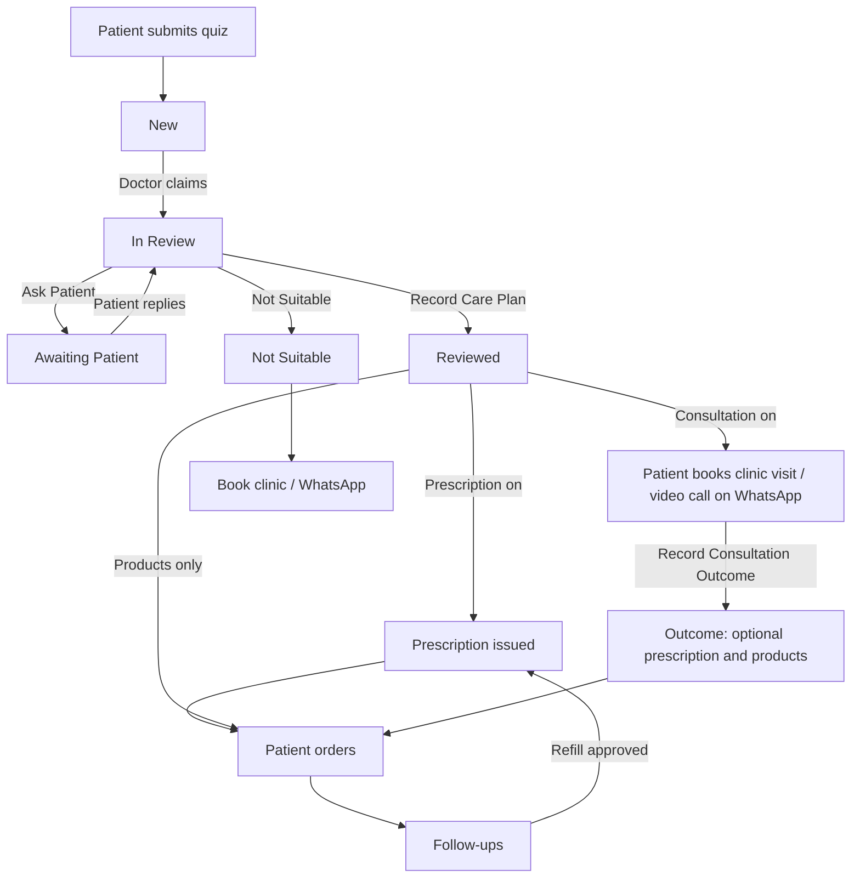
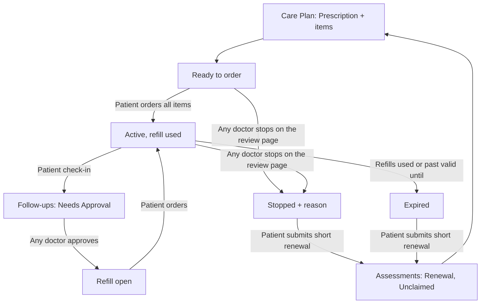

# Assessment Flow (Staff)

How doctors work through submitted assessments in the dashboard, from the patient's quiz to a care plan. It
covers the staff side before follow-ups. Patient-side states: `docs/patient-journey.md`. Follow-ups after the
order: `docs/patient-journey-simple.md`.

- Queue: `/dashboard/assessments` (`views/pages/dashboard/assessments.php`)
- Review page: `/dashboard/assessment?id=<assessment id>` (`views/pages/dashboard/assessment.php`)
- Components: `views/components/dashboard/assessment-row.php`, `assessment-answers.php`, `assessment-decision.php`,
  `assessment-thread.php`, `assessment-checkins.php`
- Statuses, decisions and seed data: `includes/assessments-data.php`
- Session store, actions and queue groups: `includes/assessments-state.php`
- Quiz questions: `includes/assessment-quiz-data.php`
- Patient summary field: `assessment` in `includes/dashboard-patients-data.php`
- Patient record: `/dashboard/patient?id=<patient id>` (`views/pages/dashboard/patient.php`)
- Workflow reference for doctors and product owners: `/dashboard/assessment-workflow`
  (`views/pages/dashboard/assessment-workflow.php`)
- When a status, rule or transition here changes, update this file in the same commit.

Status: ✅ built · ⚠️ partial · ❌ missing

---

## Flow



1. **Queue**: the doctor opens the Assessments list and claims an unclaimed case.
2. **Review**: quiz answers, photos, health flags, patient history (past orders, care products bought) and an
   internal note.
3. **Decision**: the doctor picks one action:
   - **Ask Patient**: sends a question. The case waits for the reply, then goes back to In Review.
   - **Record Care Plan**: any of Prescription, Recommended Products and Consultation (Clinic Visit or Video
     Call), each behind a switch. See [Care Plan form](#care-plan-form-).
   - **Not Suitable**: the patient is referred to the clinic.
4. **Prescription**: with Prescription on, saving the plan issues the prescription (see
   [Prescriptions](#prescriptions)).
5. **Consultation**: with Consultation on, the patient books on WhatsApp. Afterwards the doctor records the
   outcome on the same assessment and may add a prescription or products then.
6. **Handover**: after a care plan the patient orders, and the order starts the follow-up chain
   (`/dashboard/follow-ups`).

---

## Linked records

Doctors are the only dashboard users, so there is no separate Prescriptions page or sidebar link. Each record
lives where it is created and is listed on the patient:

```
Patient ─┬─ Assessment (submit → review → decision)
         │      └─ Prescription (issued with a Prescription care plan)
         │             └─ Follow-ups / refills
         └─ The patient record lists all of the above
```

| From | To | Status |
|---|---|---|
| Assessment review → Patient History | Patient record (View Patient Record) | ✅ Patients directory only (not PT-2001) |
| Patient record → Assessments card | Each assessment review (Review / View) | ✅ |
| Assessment review → Decision | Prescription issued from the Care Plan form | ✅ |
| Patient record → Prescriptions | Prescriptions card, linked to the source assessment | ✅ Ready, Active, Expired, Stopped (date and reason) |
| Follow-up refill request → Prescription | Prescription panel in the drawer, linked to the assessment | ✅ |
| Follow-up row → Prescription and assessment | Source of the refill | ❌ |

---

## Statuses

| Status | Meaning | Owner | Next |
|---|---|---|---|
| New | Submitted, nobody has claimed it | Any doctor | Claim → In Review |
| In Review | Claimed; the doctor is reviewing | Claiming doctor | Ask Patient, Record Care Plan or Not Suitable |
| Awaiting Patient | The doctor asked a question | Patient | Reply → In Review (same doctor) |
| Reviewed | Care plan recorded | — | Patient orders → Follow-ups |
| Not Suitable | Not suitable for online care | — | Patient books a clinic visit or uses WhatsApp |

### Mapping to other surfaces

| Assessment status | Patient state (`/account`) | Patient list (`assessment` field) |
|---|---|---|
| — (no assessment) | `new` | Not Submitted |
| New, In Review | `pending` | Pending Review |
| Awaiting Patient | `needs_info` | Pending Review |
| Reviewed | `plan_ready` | Reviewed |
| Not Suitable | `not_suitable` (live only) | Reviewed |

### Live link with `/account`

The dashboard and `/account` share one session store (`includes/assessments-state.php`). The demo patient is
`account_patient` (PT-2001, Aisyah) in `includes/assessments-data.php`; her assessment is AS-3004 (New).

- `/account` (live, the default preview) shows her latest assessment above her orders, mapped as in the table
  above. `views/pages/account.php` builds `$account_live_assessment`; `views/pages/account/full.php` merges it
  over the sample.
- Awaiting Patient: `/account` shows the latest question. The reply posts to `/account` (`action=patient_reply`,
  `assets/js/account-reply.js`); the case returns to In Review with Patient Replied. Photos are counted only.
- Reviewed: the doctor’s message is the plan note (the consultation outcome message once recorded). The plan
  lists the prescription items and the recommended products (sample products only for plans saved without
  items). A pending consultation replaces the WhatsApp button with **Book a Clinic Visit** or **Book a Video
  Call** (WhatsApp, prefilled from `consultation.whatsapp`).
- Not Suitable: “Your doctor’s advice” with the message and WhatsApp.
- Earlier rounds: answered questions show above the open question (Awaiting Patient), and under “Your messages
  with <doctor>” in the other states (`thread_history`, `account/doctor-thread` `history`).
- Questions asked about one answer show “About your answer: …” above the doctor’s bubble (`message_about`,
  history `about`).
- The session reseeds when the seed data changes, or with Reset Demo.

---

## Rules

| Rule | Value |
|---|---|
| Claiming | Self-claim. A doctor claims a New case from the queue; the case is then theirs |
| One owner | Only the claiming doctor can ask, record a plan or mark Not Suitable |
| Questions | No limit. Each Ask Patient → reply round is kept in the case thread |
| Patient reply | Returns the case to In Review with the same doctor |
| Decision | One final decision per assessment: Record Care Plan or Not Suitable |
| Care plan parts | Prescription, Recommended Products, Consultation (Clinic Visit or Video Call), in any mix; at least one. The stored `decision` is derived for older views: prescription, else basic, else consultation |
| Consultation | Booked on WhatsApp. The doctor who recorded the plan records the outcome on the same assessment; the case stays in their Mine until then |
| Prescription | Issued only from an assessment with a Prescription care plan. Belongs to that assessment and patient |
| Purchase | A care plan does not require a purchase. Buying a basic product never marks a prescription as fulfilled |
| Internal note | Staff only. Never shown to the patient |

---

## Screens

### Queue (`/dashboard/assessments`) ✅

- Collapsible groups, as on Follow-ups: Unclaimed (New), Mine (In Review, Awaiting Patient, and Reviewed with a
  pending consultation), Reviewed (Reviewed and Not Suitable, last 14 days, all doctors).
- Row: assessment and patient ID, name, photo count, reported changes, when first noticed, health flags, status,
  date (Submitted, Asked or Decided) and a hint (waiting time, question round, or plan label and doctor). A
  pending consultation adds a Clinic Visit Pending or Video Call Pending badge.
- Order: Unclaimed oldest first. Mine: patient replies (Patient Replied badge), then In Review oldest first, then
  Awaiting Patient, then pending consultations. Reviewed newest first.
- Actions: Claim (Unclaimed, posts and moves the case to Mine), Review (Mine, including pending consultations),
  View (Reviewed).
- Demo: Mine belongs to the `signed_in` doctor in `includes/assessments-data.php`. Reset Demo (`?reset=1`)
  reseeds the session.

### Review page (`/dashboard/assessment?id=`) ✅

One column of tabs, one task per tab, each with its own form and a lead line saying what the tab is for:

- **Review**: Renewal (renewals only), Answers (health flags as badges, then every quiz answer), Questions, Photos
  (placeholders in the demo). Ends with **Continue to Outcome** (link to `?tab=outcome`) while the signed-in
  doctor's assessment is In Review.
- **Outcome**: Decision.
- **Patient**: Patient History (contact, last purchase, clinic visits, treatment), Check-ins, Internal Notes.
- Open tab: `?tab=` when set (the PRG redirect adds it: ask and demo reply → Review, note → Patient, other actions
  → Outcome), otherwise Outcome when decided or New, Review otherwise.
- Questions (the conversation, not a decision): the thread, then **Ask the Patient** while In Review, or the wait
  for a reply with Add Demo Reply (demo only) while Awaiting Patient.
- Answers: grouped (Profile, Hair, Health and Goal) with short labels from `answer_labels` in
  `includes/assessments-data.php`; the full quiz question is in a tooltip. A flag icon hangs left of the option
  (text stays aligned) for options listed in `flags` in `includes/assessments-data.php` (`<question ID>:<option>`
  => tooltip text; every health condition except “None of these” for now), and `Q<n>` markers (monospace) sit
  before its checkbox, both with
  tooltips. Each row ends with a 40px checkbox
  (`forms/choice` `size: large`) while asking is possible. A multiple-choice answer keeps one label and stacks
  its chosen options in the answer column, split by dashed dividers, so each option can be asked about on its own: `about[]` holds
  `<question ID>:<option>`. A plain question ID (older rounds) means the whole answer and marks every row of it.
- Ask the Patient is one question per round. Ticked answers become removable chips (`chip` component) above the
  question; a chip’s × unticks its answer. With no chips it is a general question. **Request Photo** asks for a
  photo; **Send Question** posts `question`, `about[]` and `photo`. The thread shows the referenced answers as
  badges and “Photo requested”; on `/account` the patient sees “About your answers: …” and “Please add a photo
  when you reply.” While New or Awaiting Patient, the Answers card says why asking is not available. Chips need
  `assets/js/assessment-ask.js`; without it, chips from a rejected submit still post.
- Check-ins: the patient’s self check-ins from `/account/treatment/checkin` (follow-ups session, `source = self`),
  newest first: product, order, date, outcome, refill and the answers. Read only.
- Outcome tab: Decision (final decisions only). Patient tab: Internal Notes (list + Add Note for the claiming
  doctor, any status).

| State | Decision card |
|---|---|
| New | Claim Assessment |
| Claimed by another doctor | Read only: who owns it |
| Awaiting Patient (mine) | Waiting for the reply in Questions |
| In Review (mine) | Tabs: **Care Plan** (switches for Prescription, Recommended Products, Consultation; message → Save Care Plan), **Not Suitable** (message → Mark as Not Suitable) |
| Reviewed / Not Suitable | Outcome, plan label (e.g. Prescription + Products + Video Call), consultation (Pending or Done date), date, doctor, prescription (items, status, refills, valid until), recommended products, message for patient, consultation outcome |
| Reviewed, consultation pending (mine) | The summary, then **Consultation Outcome**: the Care Plan form without Consultation (Prescription only if none was issued), message → Save Outcome |

Validation (server-side, `includes/assessments-state.php`): asking needs a question. A care plan needs at least
one part switched on and a message. Prescription on: at least one item, each with a dosage and 1–180 days per
order, 1–12 refills and a validity of 3, 6 or 12 months. Recommended Products on: at least one product.
Consultation on: Clinic Visit or Video Call. The consultation outcome needs a message; its parts are optional,
and it can’t add a second prescription. Not Suitable needs a message. A note needs text. Only the claiming doctor can ask, decide or add notes;
asking and deciding only while In Review. After a rejected submit the same form (and tab) opens with its input.
`layout-dashboard.php` loads `assets/js/tabs.js`, `assets/js/assessment-ask.js` and `assets/js/overlays.js`
(tooltips) for the Assessments pages.


### Patient record (`/dashboard/patient?id=`) ⚠️

- Patient Record card (summary from `includes/dashboard-patients-state.php`), then **Assessments**: the patient’s
  assessments from the session store, newest first. Row: ID, submitted date, care plan, doctor, status badge,
  and Review (open) or View (Reviewed, Not Suitable).
- The review page links back from Patient History with **View Patient Record**, for patients in the Patients
  directory. PT-2001 (the `/account` demo patient) lives only in `includes/assessments-data.php`, so it has no
  link.
- **Prescriptions**: prescriptions issued with the patient’s assessments, newest first: ID, status, items with
  dosage and supply, issued, valid until, refills, doctor, and a link to the source assessment.
- Follow-ups are not listed yet.

---

## Prescriptions

A prescription is created on the review page, in the Decision card’s **Care Plan** tab, when the plan type is
Prescription. There is no separate Prescriptions page. Care Plan items ✅; refill approval ✅ (Follow-ups,
`docs/patient-journey-simple.md` → Refill approval); renewal ✅ (see Renewal); Stopped ✅ (see Stop).
`used` counts orders: seeds set it (AS-2990: 1), each approved refill adds one.



### Care Plan form ✅

One form with three switched sections, divided by dashed lines (`views/components/dashboard/assessment-decision.php`):
**Prescription**, **Recommended Products** and **Consultation** (Clinic Visit or Video Call). Any mix is valid;
at least one must be on. A section’s fields show only while its switch is on, and a product’s dosage and supply
only while it is ticked: CSS `:has()` through Tailwind variants, no JS. Hidden fields still post, so the server
reads only switched-on sections and ticked items. Limits: `prescription` in `includes/assessments-data.php`.
The same component (`form: 'outcome'`) renders the Consultation Outcome form without the Consultation section.

The Prescription section:

| Field | Notes |
|---|---|
| Items (one or more) | Product: only products with `requirement` Prescription Required (`includes/dashboard-products-data.php`) |
| Dosage | Per item. Prefilled from the product’s `rx_dosage`; the doctor can change it. Shown to the patient |
| Supply | Per item: days per order. Prefilled from the product’s `rx_supply_days`; the doctor can change it |
| Refills | Orders allowed, including the first (1–12, default 5). One count per prescription, not per item |
| Valid for | 3, 6 or 12 months from issue (default 6) |
| Message for Patient | Existing field |

Recommended Products: active basic products, no dosage, supply, refills or validity; the patient can buy them
any time. Consultation: Clinic Visit or Video Call; the patient books on WhatsApp.

The plan label joins the parts that are on, e.g. “Prescription + Products + Video Call”
(`assessment_plan_label()`). The stored `decision` stays one of prescription, basic or consultation, derived from
the parts, so `/account` status mapping keeps working.

On Save Care Plan the assessment record gets `prescription`: `id` (`RX-` + assessment number), `issued_on`,
`valid_until`, `refills` and `items` (`product_id`, `dosage`, `supply_days`). The assessment gives the patient
and doctor. Recommended Products saves `products` (product IDs). Consultation saves `consultation`: `mode`,
`status` (pending, done), `done_on`, `message` (the outcome). Seeds: AS-2990 (prescription), AS-2984 (products),
AS-2992 (video call pending, `rujhan`).
The Decision summary (Reviewed), the patient record and the `/account` plan (live) show them.
`/account/prescriptions` still shows sample data (preview states), not the session.

### Rules

| Rule | Value |
|---|---|
| Where | Issued only from the Care Plan tab of an assessment. No separate Prescriptions page |
| Defaults | Each prescription product has a default dosage and supply. The doctor can edit them per item |
| Limit | Refill count and valid until. The prescription expires at whichever comes first |
| Ordering | One order covers every item. Each order uses one refill |
| Refill | Needs a patient check-in and a doctor’s approval for every refill |
| Refill approver | Any doctor. Approved in Follow-ups (`/dashboard/follow-ups`): the prescription refill row shows Needs Approval; a doctor reviews the check-in, then Approves or Reviews Again; to stop, View AS-… opens the review page. No claim step: the first save wins ✅ |
| Change | No edits after issue. To change a dose or stop treatment, the doctor stops the prescription with a reason and issues a new one |
| Expiry | The patient submits a short renewal; no full quiz. It enters the Assessments queue (Unclaimed) as Renewal, for any doctor |
| Renewal form | The 4 check-in questions (`includes/checkin-data.php`) plus the quiz Health question, and Top, Front and Crown photos (required) |

### Statuses

| Status | Meaning | Patient sees (`/account/prescriptions`) |
|---|---|---|
| Ready | Issued, not ordered yet. ✅ | Ready to order |
| Active | Ordered at least once; refills and validity left. ✅ `used` > 0 | Active |
| Stopped | Ended early by a doctor, with a reason. ✅ `stopped_on`, `stopped_by`, `stop_reason` | Stopped (live `/account`: alert with the reason and Renew Prescription) |
| Expired | Refills used or past valid until. ✅ `used` ≥ refills or past valid until | Expired |

### Renewal ✅

- Open on `/account/renewal` (Renew Prescription on `/account/prescriptions`) when the account patient’s
  latest prescription has expired and no renewal is open. Seed: AS-2950 (PT-2001, RX-2950 expired).
- Submitting creates a New assessment with `type` `renewal`, `renewal_of` (assessment ID) and `checkin`
  (answers). Profile and hair answers are copied from the renewed assessment; Health is answered again.
- Queue: Renewal badge, “Renewing RX-…” and “Since last plan: …” in place of changes and onset.
- Review page: Renewal card (previous prescription, check-in answers) and photo sets for this renewal and the
  previous assessment. The doctor records a new Care Plan as usual.

### Stop ✅

- Review page Decision summary: a Ready or Active prescription has **Stop Prescription**. A modal asks for the
  reason (required, shown to the patient). Any doctor can stop it, like refill approval.
- Stopped blocks refill approval in Follow-ups (Approve Refill disabled, “was stopped” notice) and opens a renewal.
- Shown as Stopped with date, doctor and reason on the review page and the patient record. Live `/account`: the
  prescription items leave the plan and an alert shows the reason with Renew Prescription.
- To change a dose, the doctor stops the prescription, then issues a new plan on the renewal (or a new assessment).

### Still to build

- Default dosage and supply in the product edit form (`rx_dosage`, `rx_supply_days` are data only for now).
- `/account/prescriptions` reading the session prescription for the live patient.

---

## Gaps

| Item | Status | Notes |
|---|---|---|
| Queue page with self-claim | ✅ | Session demo, no database |
| Review page with decision form | ✅ | Session demo |
| Patient replies from `/account` | ✅ | AS-3004 only; Add Demo Reply for the other patients |
| Real photos | ❌ | Placeholders by view (Top, Front, Crown) |
| Prescription items on Record Care Plan | ✅ | Items, dosage, supply, refills, validity; recommended products on any plan |
| Consultation (clinic visit, video call) | ⚠️ | Booked on WhatsApp; outcome recorded on the assessment. No booking calendar or video link |
| Session demo state shared with `/account` | ✅ | Live preview only; other previews use sample data |
| Plan products from the doctor | ✅ | `/account` live plan; sample products only for plans saved without items |
| Staff sign-in | ❌ | Mine uses a fixed demo doctor (`signed_in`) |
| Patient list `assessment` field and `doctor` | ⚠️ | Separate seed in `includes/dashboard-patients-data.php`; not read from assessments |
| Multiple question rounds on `/account` | ✅ | Answered rounds show above the open question, then as “Your messages with <doctor>” |
| `not_suitable` patient state | ⚠️ | Live only; no `?state=` preview yet |
| Prescription flow | ⚠️ | Issued from the Care Plan tab ✅; refill approval in Follow-ups ✅; renewal ✅; Stopped ✅ |
| Renewal photos | ❌ | Files are counted, not stored; the review page shows placeholders |
| Patient record ↔ assessments | ✅ | Assessments card on the patient record; View Patient Record on the review page |
| PT-2001 patient record | ❌ | Not in the Patients directory, so the review page has no record link |
| Overview counts linked to the queue | ⚠️ | `includes/dashboard-overview-data.php` shows sample counts; "View assessments" has no target |

---

## Open questions

- Can a doctor release a claimed case back to the queue, for example when unavailable?
- What happens when a patient never replies to a question: reminder, auto-close, or stays open?
- Not Suitable: fixed reasons list or free text? What does the patient see?

---

## Changelog

- 2026-11-25: Stop Prescription on the review page (reason required, any doctor). Stopped blocks refills,
  opens a renewal and shows on the review page, patient record, Follow-ups and live `/account`.
- 2026-11-25: Renewal: `/account/renewal` (3 photos, check-in, Health) creates a Renewal assessment in
  Unclaimed; the review page shows the prescription being renewed, the check-in and both photo sets.
- 2026-11-25: Prescriptions count orders (`used`); Active status; refills approved in Follow-ups.
- 2026-11-25: Care Plan is one form with switches (Prescription, Recommended Products, Consultation) in any mix.
  Consultation (Clinic Visit or Video Call) is booked on WhatsApp; the doctor records the outcome on the same
  assessment and may add a prescription or products then.
- 2026-11-25: Care Plan form records prescription items (dosage, supply, refills, validity) and recommended
  products; Decision summary, patient record and `/account` plan show them.
- 2026-11-25: Refills approved in Follow-ups. Renewal: check-in questions, Health and 3 photos; any doctor.
- 2026-11-25: Prescription rules agreed: product defaults, refill count plus validity, check-in and approval
  by any doctor for each refill, stop and reissue, short renewal on expiry, Basic Products picks products.
- 2026-11-25: Prescriptions removed from the dashboard sidebar; prescriptions are issued from the Care Plan tab.
  Patient record lists assessments; the review page links to the patient record.
- 2026-11-25: Flag rules moved to `flags` in `includes/assessments-data.php`.
- 2026-11-25: Flag as an icon and asked rounds as Q<n>, both with tooltips.
- 2026-11-25: Multiple-choice answers list each option under one label, each with its own checkbox.
- 2026-11-25: Review page in tabs (Review · Outcome · Patient) instead of a main column and sticky aside.
- 2026-11-25: Bundle layout from the prototype: grouped answers with short labels, one question with answer chips.
- 2026-11-25: Request Photo per question.
- 2026-11-25: Ask the Patient takes several questions in one round; answers are ticked to add a question about
  them.
- 2026-11-25: Review page split by task: Ask the Patient in Questions, Decision tabs (Care Plan / Not Suitable),
  Add Note in Internal Notes.
- 2026-11-25: `/account` shows which answer a question is about; Answers explains when Ask is unavailable.
- 2026-11-25: Questions moved to the main column; Ask on each answer.
- 2026-11-25: Review page shows the patient’s self check-ins.
- 2026-11-24: `/account` shows earlier question rounds.
- 2026-11-24: Linked to `/account` (live): status mapping, patient replies, Not Suitable state.
- 2026-11-24: Review page built: answers, photos, history, decision form, question thread, internal notes.
- 2026-11-24: Queue page built: Unclaimed, Mine and Reviewed groups; self-claim.
- 2026-11-24: First version. Self-claim, unlimited question rounds and Not Suitable agreed; prescription open.
