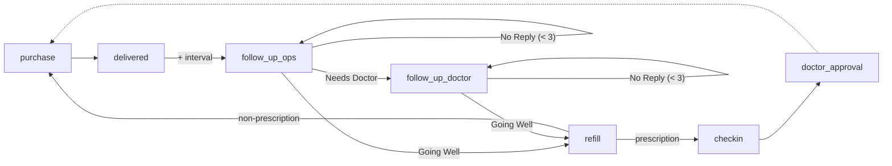

# Patient Journey (Simple)

The client-facing journey. `/account` (Overview) shows it. The detailed version stays as an internal reference
at `/account/full` (`docs/patient-journey.md`).

- Overview: `/account` (`views/pages/account.php`). Assessment states render `views/pages/account/full.php`
  unchanged; from the first order on, the page shows the product cards.
- Full version: `/account/full` (`views/pages/account/full.php`), not in the account nav. `/account/checkin`
  belongs to it and returns there.
- Self check-in: `/account/treatment/checkin` (`views/pages/account/treatment/checkin.php`).
- `/account/treatment` redirects to `/account` (old links).
- Staff page: `/dashboard/follow-ups` (`views/pages/dashboard/follow-ups.php`)
- Rules, labels and seed data: `includes/follow-ups-data.php`
- Session store, rules and lookups: `includes/follow-ups-state.php`
- Components: `views/components/dashboard/follow-up-row.php`, `views/components/dashboard/follow-up-record.php`
- When a rule, status or field here changes, update this file in the same commit.

## Journey on `/account`

```
Assessment → Doctor review → Doctor asks → Plan ready → Order → Delivery → Follow-up → Refill → (next order)
  new          pending        needs_info    plan_ready   └──────────── product cards ────────────┘
```

| Stage | Source | Kept from the full version? |
|---|---|---|
| `new`, `pending`, `needs_info`, `plan_ready` | `views/pages/account/full.php` | Yes, unchanged |
| `ordered` | Replaced by `packed`, `shipped` | No |
| `received` (pick a start date) | Removed: follow-ups count from the delivery date | No |
| `on_treatment` | Replaced by `upcoming` (supply bar, follow-up date) | No |
| `checkin_due`, `checkin_review`, `plan_updated` (Week 4/12/24) | Replaced by follow-up + self check-in | No |

Preview (`overview` group in `includes/preview-states.php`): `live` (default, session shared with the dashboard),
`new`, `pending`, `needs_info`, `plan_ready`, `packed`, `shipped`, `upcoming`, `contacting`, `retrying`, `doctor`,
`done`, `done_care`, `closed`, `stopped`. Assessment states set `$account_preview_state` and
`$overview_preview_group` before including the full page. Product states map the account data to `on_treatment`.

## Patient without an assessment

Buying any product needs an account, so every buyer lands on `/account`. A care-product buyer gets the same loop
(Order → Delivery → Follow-up → Refill, self check-in included); refills need no doctor approval.

Assessment offers (only while the patient has no assessment):

| Where | When | Copy / action |
|---|---|---|
| Box below the active cards | Always; not dismissible | Section heading "Doctor-reviewed treatment", then the `new` state's How it works steps, Start Your Assessment and inline facts (no tracker) |
| Popular everyday care, below the box | Always with the box | Quiz default products minus what the patient bought |
| On the product card | Self check-in on a care product said About the same / Worse, or More shedding (`suggest`) | "Care products may not be enough on their own…" + Start Assessment |
| On the product card | Care product follow-up is with the doctor | Same as above |

Preview: `care_shipped`, `care_upcoming`, `care_contacting`, `care_doctor`, `care_done` (account data maps to
`new`, so there is no assessment). Starting the assessment leads into the assessment states above.

## Care buyer who then sends an assessment

The assessment status (component `account/assessment-status`, the same section as the full version) sits on top,
with the page title from the assessment stage. A "Your orders" heading and the product cards follow. The
assessment offer and Popular everyday care no longer show, because the patient has an assessment.

`views/pages/account/full.php` builds the status data (`$status_view`). With `$account_embed` set it returns after
building the data, so `/account` can render the section without the full page.

Preview: `care_shipped_pending`, `care_shipped_needs_info`, `care_done_plan_ready`.

## Cards: one per product order

- **Active**: the latest order of each product, unless stopped. Full card: 4-stage tracker
  (Ordered → Delivery → Follow-up → Refill), status, delivery timeline or supply bar, doctor summary, facts,
  actions.
- **Past orders**: older orders of the same product and stopped products. Always shown below the active cards as
  muted cards (Past order badge, outcome and date, doctor summary, order facts). No actions.
- A new purchase adds a new card; the previous order of that product moves to Past orders.

Status: ✅ built · ⚠️ partial · ❌ missing

---

## The loop



Hair growth takes months, so a follow-up is the point where the next cycle starts, not the end. Each purchase gets
one follow-up chain. A refill is a new purchase, and that opens a new chain (`cycle` + 1).

---

## Core idea: one record = one contact attempt

Every action closes the current record. The outcome decides whether a new record opens.
Retries and handovers are new records that point back with `parent_id`.
Records with the same `order_id` + `product_id` form one chain.

| Outcome (value) | Operations label | Doctor label | Result |
|---|---|---|---|
| `ok` | Going Well | Going Well | Chain closes. Refill choice is required |
| `issue` | Needs Doctor | Review Again | Ops: doctor record due today. Doctor: doctor record in 7, 14 or 30 days |
| `no_response` | No Reply | No Reply | Same team retries in 3 days. After attempt 3 the chain closes |

Refill choices for `ok`: `yes` (Wants Refill), `later` (Not Yet), `stop` (Stopping).

---

## Rules

| Rule | Value | Where |
|---|---|---|
| First follow-up | `delivered` + product `interval` when the product uses "Product-specific Interval", else `default_interval` | `follow_up_interval()` |
| Default interval | 23 days (a week before a 30-day supply ends) | `rules.default_interval` |
| Supply length | 30 days | `rules.supply_days` |
| Retry gap | 3 days | `rules.retry_days` |
| Max attempts | 3 per team | `rules.max_attempts` |
| Doctor review choices | 7, 14, 30 days | `reviews` |
| Who records | Operations first, then the doctor | `teams` |
| Contact channel | WhatsApp prefilled text only (`wa.me`). The system cannot tell if a message was sent, so staff record by hand | `follow_up_whatsapp()` |

Validation (server-side, `includes/follow-ups-state.php`): an outcome is required. A refill choice is required for
`ok`. A note is required for `issue`. The doctor's `issue` needs a review interval. Patient summary is only kept
for doctor records and is dropped for `no_response`.

---

## Record fields

| Field | Meaning |
|---|---|
| `id`, `parent_id` | `FU-####`; previous record in the chain (`''` for the first) |
| `patient_id`, `order_id`, `product_id` | Who and what |
| `journey_start` | First delivery of this product (for "Month N of your treatment") |
| `delivered`, `cycle` | This order's delivery date; order number for this product (1, 2, 3…) |
| `attempt`, `team` | Attempt number for this team; `ops` or `doctor` |
| `due` | Date to contact |
| `outcome`, `refill` | `''` while open |
| `note` | Internal, staff only |
| `summary` | Doctor's summary, shown to the patient |
| `done_by`, `done_on` | Who recorded it and when |
| `source` | `''` staff, `self` patient check-in |
| `suggest` | Self check-in on a care product showed little progress (assessment offer) |

Seed dates in `follow-ups-data.php` are day offsets from today, so the demo always has overdue, due and upcoming
work. The first record of a chain has no `due`: it comes from the interval rule.

---

## Patient self check-in (`/account/treatment/checkin?id=<latest record id>`)

Separate page from `/account/checkin` (full version); both share the questions in `includes/checkin-data.php`.
Page: `views/pages/account/treatment/checkin.php`. POST handled in `includes/follow-ups-state.php`.

| Rule | Detail |
|---|---|
| When it opens | Ops follow-up due or overdue; after Going Well with a prescription refill; after No Reply closed |
| Once only | One self check-in per chain (`source = 'self'`); a second submit is refused |
| Steps | Photos (min 2, all products) → 4 check-in questions → "Would you like your next supply?" |
| Submit | Last answer posts the form (`assessment-quiz.js`, `config.submit`); photos are counted, not stored |
| Outcome | Stopped, worse, or any side effect → Needs Doctor (doctor record due today). Otherwise Going Well |
| Prescription + wants refill | Doctor record due today to approve the refill. After the doctor's Going Well → Order Refill |
| Care product | Going Well closes the chain → Order Refill |
| Record | Closes the open record (or adds one after Going Well); `done_by` "Patient (self check-in)"; answers become the note |
| Dashboard | Self Check-in badge; doctor rows show "Patient check-in:" with the answers |
| Preview | `?id=FU-PREVIEW` (from the `/account` preview) saves nothing and lands on `/account?state=doctor` |

Going wrong does not issue a new prescription automatically: the doctor reviews and records Review Again or
Going Well. Changing the plan or prescription is not built in this flow.

## Staff view (`/dashboard/follow-ups`)

- Groups: Overdue, Due Today, Upcoming, Completed (last 14 days). Filter by team.
- Row: patient, product, order number, delivery date, team, attempt, prescription badge, due date.
  Doctor rows show the operations note.
- Actions: WhatsApp (prefilled), Record (drawer with history and form). Completed rows with Wants Refill or
  Not Yet get Send Refill Link.
- WhatsApp text depends on team, attempt and cycle (cycle 1: early shedding can be normal; cycle 3+: most people see
  changes after 3 to 6 months).
- "Reset Demo" (`?reset=1`) reseeds the session.

## Card status (`/account`)

Status from the latest record of each chain:

| Status | When | Patient sees |
|---|---|---|
| Follow-up soon | Open, ops, attempt 1, due later | Date we'll message |
| Follow-up today | Open, ops, attempt 1, due today or earlier | We'll message today |
| Waiting for your reply | Open, ops, attempt > 1 | We tried to reach you |
| With your doctor | Open, doctor | Doctor will message |
| Follow-up done | `ok`, refill not `stop` | Thanks + refill action |
| Follow-up closed | `no_response` after the last attempt | Message us any time + refill action |
| Stopped | `ok` + `stop` | Message us to start again |

- Never shown to the patient: internal notes, "No Reply", attempt counts.
- Refill action: prescription → Start Check-in (`/account/checkin`), the doctor approves the refill after review.
  Other products → Order Refill (product page).
- Each card has the Overview's 4-stage tracker (`account/status-tracker`): Ordered → Delivery → Follow-up →
  Refill. Packing and on-the-way cards show the delivery timeline, courier and tracking instead of supply.
- Card also shows journey month, order number, supply left and the latest doctor summary.

---

## Gaps

| Item | Status | Notes |
|---|---|---|
| Follow-up queue, record form, rules | ✅ | Session demo, no database |
| Simplified Overview with active and past cards | ✅ | Sample patient `PT-2001` |
| Prescription refill approval after check-in | ⚠️ | Check-in exists; approval not linked to the chain |
| Refill order opens the next chain | ❌ | Seed data only |
| Category default intervals | ❌ | Uses `default_interval` until categories have rules |
| Real staff identity in `done_by` | ❌ | Team name or sample doctor |
| Database / API | ❌ | One `follow_ups` table with the fields above is enough |

---

## Changelog

- 2026-11-19: Combined states (care order + assessment); status section moved to `account/assessment-status`.
- 2026-11-19: Patient without an assessment: care states and assessment offers.
- 2026-11-19: Overview at `/account` is now this journey; full version moved to `/account/full`; Treatment tab
  merged into the Overview; past orders archived.
- 2026-11-19: First version.
