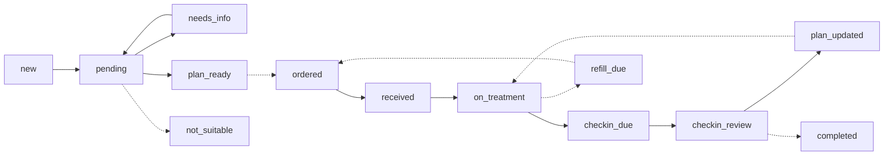

# Patient Journey

Tracks every patient state on `/account`, how patients move between them, and what is still missing,
from first assessment to the end of a treatment cycle.

- Built states live in `includes/preview-states.php` (`patient` group) and `includes/account-data.php`.
  This file covers planned states and gaps.
- When a patient state or transition changes, update the tables here in the same commit.

Status: ✅ built · ⚠️ partial · ❌ missing

---

## State map

Solid = built. Dotted = missing.

`plan_ready → ordered` still has no live link: "Order Your Plan" goes to Prescriptions, and checkout does not
return to the account. `ordered`, `received` and `plan_updated` are mockup states, previewed with `?state=`.

---

## States

| # | State | Meaning | Main action | Status | Gap |
|---|---|---|---|---|---|
| 1 | `new` | No assessment yet | Start assessment | ✅ | — |
| 2 | `pending` | Doctor reviewing | Wait / WhatsApp | ✅ | — |
| 3 | `needs_info` | Doctor asked a question | Reply in thread | ⚠️ | After replying only the title changes; no second round of questions |
| 4 | `plan_ready` | Prescription issued | Order Your Plan | ⚠️ | Button goes to Prescriptions → one product page at a time; no whole-plan order |
| 5 | `on_treatment` | Using the plan | — | ⚠️ | `started_on` is still sample data; not yet read from `received` |
| 6 | `checkin_due` | Check-in due | Start Check-in | ✅ | No overdue handling |
| 7 | `checkin_review` | Check-in sent | Wait | ✅ | Leads to `plan_updated` |
| 8 | `ordered` | Plan paid, on its way | Track Delivery | ✅ | Mockup. Delivery steps in Overview; no live entry from checkout |
| 9 | `received` | Delivered; patient picks start date | Start My Treatment | ✅ | Mockup. Today / yesterday / delivery day; form moves preview to `on_treatment` |
| 10 | `plan_updated` | Doctor's check-in outcome | Order Your Refill | ⚠️ | Mockup for Week 4 only; "plan changed" variant and loop back to `on_treatment` missing |
| — | `refill_due` | Supply nearly out | Reorder | ❌ | — |
| — | `completed` | Final check-in reviewed | Maintenance / restart | ❌ | — |
| — | `not_suitable` | Doctor declines or refers to clinic | Book clinic / WhatsApp | ❌ | — |
| — | `paused` | Supply ran out or patient stopped | Resume | ❌ | — |

---

## Transitions

| From → To | Trigger | Status | Notes |
|---|---|---|---|
| `new` → `pending` | Patient submits assessment | ✅ | |
| `pending` → `needs_info` | Doctor asks | ✅ | |
| `needs_info` → `pending` | Patient replies | ⚠️ | No distinct "reply sent" state |
| `pending` → `plan_ready` | Doctor issues plan | ✅ | |
| `pending` → `not_suitable` | Doctor declines / refers | ❌ | |
| `plan_ready` → checkout | Patient orders | ⚠️ | Fragmented: prescriptions → product → cart → checkout |
| checkout → account | Order placed | ❌ | `checkout/?complete=1` has no link back, no state change |
| `ordered` (placed → packed → on the way → delivered) | System / courier | ✅ | Mockup, in Overview |
| `ordered` → `received` | Courier marks delivered | ✅ | Mockup. Starting the treatment confirms receipt |
| `received` → what's next | — | ✅ | How to use, early shedding is normal, first check-in |
| `received` → `on_treatment` | Patient picks start date (today / earlier) | ⚠️ | Form works; chosen date not yet used for supply day or check-in dates |
| order problem (damaged / missing) | Patient reports | ❌ | |
| `on_treatment` → `checkin_due` | Date reached | ✅ | |
| `checkin_due` → `checkin_review` | Patient submits check-in | ✅ | `includes/checkin-data.php` routes |
| `checkin_review` → `plan_updated` | Doctor responds | ✅ | Mockup: note, changes, next check-ins, refill |
| check-in → doctor needs more info | Doctor asks | ❌ | `needs_info` covers assessments only |
| `plan_updated` → `on_treatment` (Week 12, 24) | Patient continues / refill | ⚠️ | `checkin_index` added; other states still read `checkins[0]` / `[1]` copy |

---

## Supply and refill

| Item | Status | Notes |
|---|---|---|
| Low-supply warning (~7 days left) | ❌ | Bar shows days left, no CTA |
| Refill from Overview | ❌ | Exists in Prescriptions (`active`) only |
| Refill delivery continues day count | ❌ | Supply is a single 30-day cycle |
| Supply ran out, no reorder | ❌ | Needs `paused` |
| Prescription expires mid-treatment | ⚠️ | Prescriptions page handles `expired`; Overview does not |

---

## End of cycle

| Item | Status | Notes |
|---|---|---|
| Final check-in (Week 24) → results summary | ❌ | |
| Completed / maintenance / continue | ❌ | |
| Patient stops or pauses | ❌ | |
| Side effects outside check-in schedule | ⚠️ | WhatsApp only |
| Restart after completion | ❌ | New assessment vs renew undecided |

---

## Open questions

- Refill and later check-ins: reuse existing states with a cycle counter, or give each its own state?
- No receipt confirmation after delivery: remind, then assume started after 7 days?
- Future start dates: allow, or only today / past dates?
- Does a refill skip receipt confirmation and start-date picking?
- Restart after completion: new assessment or prescription renewal?

---

## Changelog

- 2026-11-19: Mockup states `ordered`, `received`, `plan_updated` added to `/account`.
- 2026-11-19: First version. 7 states built; gaps listed from review.
